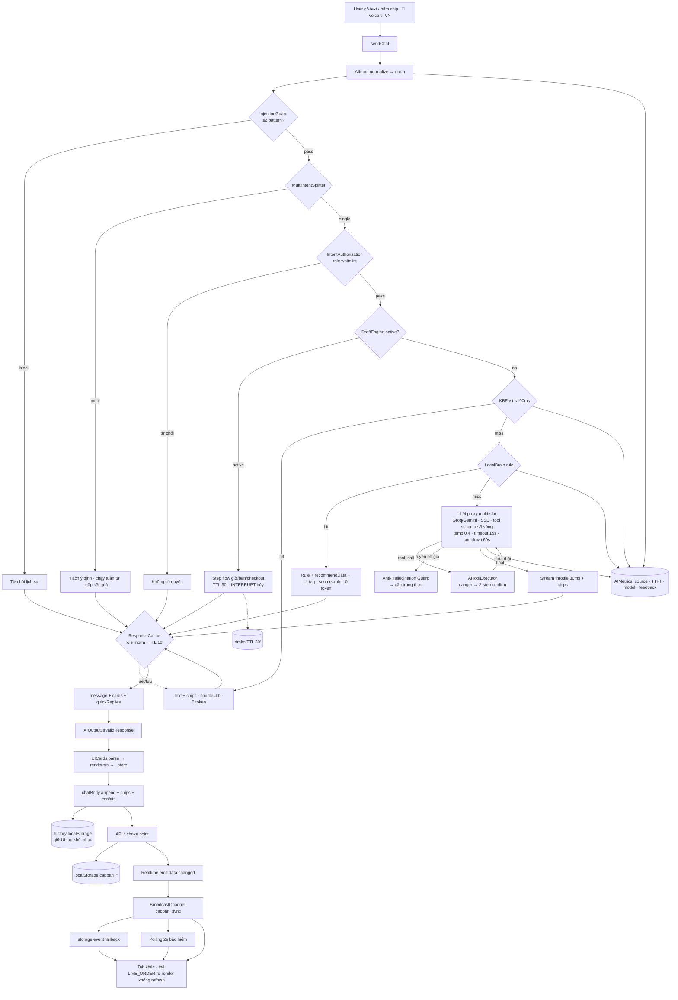

# BÀI 3 — DEEP-DIVE AI ENGINE & CHATBOT CAPPAN (Deep Technical Explanation — trọng tâm AI)

> Đối chiếu trực tiếp mã nguồn AI: `js/ai/brain.js` v5.0 (ULTRA SMART CHATBOT — Fast-Path <100ms · Smart Router · Multi-Intent · Context Engine · Taste/Health Aware · Precision Tool-Calling · Generative UI), `ai-input.js`, `ai-output.js`, `injection-guard.js`, `intent-authorization.js`, `multi-intent-splitter.js`, `chat-interactions.js`, `brain-legacy.js`, `emotional-handler.js`, `handover.js`, `proactive.js`, `user-memory.js`, `item-lookup.js`.

---

## SECTION 1 — AI SYSTEM OVERVIEW & PIPELINE ARCHITECTURE

### Nguyên lý: tier cascade, không phải "một model giải quyết hết"

Động cơ CAPPAN tổ chức như một **cascade**: câu input rơi từ tầng rẻ nhất xuống tầng đắt nhất, **tầng nào giải được là dừng, không đi tiếp**.

| Tầng | File | Điều kiện giải | Chi phí |
|---|---|---|---|
| InjectionGuard | `injection-guard.js` | Phát hiện ≥2 pattern → chặn ngay | 0 |
| MultiIntentSplitter | `multi-intent-splitter.js` | Tách câu ghép | 0 |
| IntentAuthorization | `intent-authorization.js` | Ý định vượt quyền → chặn | 0 |
| DraftEngine | `brain.js` (drafts TTL 30') | Đang giữa luồng → xử lý bước kế | 0 |
| KBFast (Fast Path) | `brain.js` FAST_PATH + `kb.js` | Câu tĩnh (chào/cảm ơn/wifi/giờ/hotline/đỗ xe...) | 0, <100ms |
| LocalBrain | `brain-legacy.js` | Ý định sở thích/nghiệp vụ khớp rule | 0 |
| LLM | `brain.js` slots | Chỉ hội thoại mở sót lại | Token |

**Bằng chứng cascade hoạt động:** golden set 21 case — phân bố tầng **kb=6, rule=15, cần LLM=0**. Tức phần lớn hành vi chatbot là deterministic, offline, 0 token.

### Giao tiếp module

Các file AI tách biệt nhưng nối qua **namespace toàn cục có hợp đồng**: `AIBrain` (pipeline, slots, tool executor), `LocalBrain` (rule/ý định), `UICards` (parse + renderers), `AIInput` (normalize), `AIMetrics` (source/TTFT). Middleware wrap bằng **decorator pattern thuần** — thêm lớp không sửa lõi. AI context riêng theo tab qua `sessionStorage`, state nghiệp vụ qua `localStorage` + realtime event `cappan:sync`.

**Ưu:** tức thì, chi phí 0 phần lớn, test trong VM Node (5 suite ~200 case xanh). **Nhược (thừa nhận):** rule cần bảo trì khi menu lớn lên — nhưng rule đọc/khắc phục được, không phải hộp đen.

---

## SECTION 2 — DEEP-DIVE AI CHATBOT ENGINE

### 2.1 Input & chuẩn hóa (`ai-input.js`)

`AIInput.normalize()`: lowercase → bỏ dấu tiếng Việt → dò tín hiệu (`_isGreeting`, `_isThanks`, `_isCancel`, địa chỉ...). `norm` là đầu vào chuẩn của **mọi** tầng, kể cả key cache — nhờ vậy "TRÀ ĐÀO" và "tra dao" là một ý.

### 2.2 Lớp an toàn (cấm bypass)

- **InjectionGuard:** đếm pattern injection khớp; **≥2 → block**, 1 → log-only. Logic này tránh chặn oan câu tự nhiên có 1 từ trùng. 7 test dedicated.
- **IntentAuthorization:** bảng whitelist role cho từng ý định/tool; `search_customer_history`, `get_recipe`, advance → staff-only; khách gọi → từ chối lịch sự. **Quyền kiểm trước suy luận** — model không thể vượt.

### 2.3 MultiIntentSplitter

"cho 2 trà đào **rồi** tra đơn cho em" → tách 2 ý định, chạy tuần tự, **gộp 1 lượt trả nhiều thẻ**. 9 test case.

### 2.4 DraftEngine — bot "nhớ" bằng state, không bằng context

Luồng nhiều bước (đặt bàn, checkout) lưu draft trong localStorage **TTL 30 phút**:
- User reload tab → flow tiếp tục chỗ đang dở.
- Đổi chủ đề (**INTERRUPT**) → draft tự hủy, không kẹt user.
- Bước nhạy cảm (checkout, cancel) là **"lance chốt"** bắt xác nhận — không nhảy cóc.
- Cache bị **skip khi draft active** — tránh trả lời cache sai ngữ cảnh flow.

### 2.5 KBFast (Fast Path <100ms)

`FAST_PATH.match(inp)` trong brain.js: trả lời tĩnh từ `kbGet` — giờ mở cửa `07:00 - 22:30`, wifi `CAPPAN_Free / cappannguyen`, hotline `0366 444 038`, đỗ xe, địa chỉ; chào/cảm ơn/hủy có câu riêng; có **exception rõ ràng**: câu muốn *sửa địa chỉ giao hàng* không bị bắt nhầm bởi pattern "địa chỉ" (biến `isUpdateAddr` chặn trước).

### 2.6 LocalBrain — intent theo sở thích + handler nghiệp vụ

`brain-legacy.js` (70KB rules):
- **Tín hiệu sở thích:** cafein/ngọt/béo/đắng/chua/thanh/temperature/maxPrice/popular/fresh → lọc + xếp hạng 24 món thật trong `seed.js`, mỗi món kèm `reason` audit được.
- **Sức khỏe:** "đau dạ dày" → tránh cafein mạnh; "khó ngủ" → không cafein → thẻ MENU tiêu đề riêng.
- **Handler nghiệp vụ:** compare (qua `item-lookup.js`), booking flow, order flow, cancel, rating, promo, KPI, customer 360, shift... mỗi handler trả `message + cards + quickReplies`.
- **Miss → LLM:** không khớp rule nào mới đi lên.

### 2.7 LLM layer — multi-slot proxy & tool-calling

- **Slots** = provider × model × key: Groq `openai/gpt-oss-20b` & `gpt-oss-120b`, Gemini `gemini-3.8-flash` & `gemini-3.6-flash`; qua Cloudflare Worker proxy (`https://cappan-proxy...workers.dev`, header `X-Access-Token`), parse **SSE stream**; kiểm health `/health` lúc khởi động.
- **Config:** temperature 0.4, timeout 15s, cooldown 60s. `pick(exclude)` chọn slot không bị cooldown; 429 → `cool(slot, 60s)`; lỗi provider → `coolProvider`. Cooldown lưu `sessionStorage cappan_ai_cool` — sống qua reload trong tab.
- **Tool-calling:** schema chặt; tối đa **3 vòng** tool-call; executor chạy thật trên `API.*`; tool **danger** (hủy đơn/bàn) bắt **2-step confirm** bằng thẻ confirm; `genToolCallId` sinh call-id riêng.
- **Content limit thông minh:** lượt có `[UI_` tag được nới giới hạn 6000 ký tự, thường 800 — bảo vệ context không loãng.
- **Fallback trung thực:** hết slot → câu lịch sự + hotline; **không bao giờ tuyên bố mutation giả**.

### 2.8 Anti-Hallucination Guard

Cuối mỗi lượt LLM: đối chiếu **tuyên bố mutation trong text** (xóa/advance/đặt) ↔ **tool-call thực sự chạy**. Lệch → thay bằng câu trung thực. Đi cặp với 5 test **partial-refusal**: bị bức ép → từ chối đúng phần quá quyền, vẫn đáp phần được phép.

### 2.9 Generative UI Engine

```
Bot: "...text...\n[UI_COMPARE]{json}[/UI_COMPARE]"
  → AIOutput.isValidResponse (validate)
  → UICards.parse (tách tag)
  → renderers.COMPARE(payload)  ← hàm JS cố định
  → thẻ DOM trong bubble + _store (modal phóng to)
```

- **AI chỉ quyết định thẻ nào + dữ liệu gì**; vẽ và chạm DOM là code — escapeHtml toàn bộ, `_safeHref` whitelist link, event delegation cho tương tác.
- **~35 renderers**; `chat-interactions.js` còn decorator nâng cấp vài renderer (LIVE_ORDER...).
- **LIVE_ORDER:** emit `data-live-order="ID"` → `main.js _liveWatch` tạo **setInterval 6s**: mỗi tick đọc `API.orders.getById(id)`, `_paintLive` vẽ lại timeline 5 bước (`Chờ xử lý → Đang pha → Shipper lấy → Đang giao → Hoàn tất`), thanh tiến trình %, iframe Google Maps theo `SHIPPER_DATA.coords[newStep]`, vị trí text `ui-live-loc`, cờ **"● LIVE"** khi step 2–3; **tự hủy timer** khi step≥4/cancelled/thẻ gỡ khỏi DOM.
- **Khôi phục lịch sử:** history lưu nguyên `[UI_]` tag → sau refresh thẻ vẽ lại đủ.

### 2.10 Trải nghiệm hội thoại tinh tế

| Cơ chế | Hoạt động |
|---|---|
| **Typing stream** | `_throttleChunk` render ~30ms/lần — mượt, không nhấp nháy token; ngắt nghỉ theo cụm câu |
| **ResponseCache** | exact-normalized key `role + '|' + norm`, TTL 10'; hit ghi history; **skip draft active**; cố ý không fuzzy |
| **Voice Input** | Web Speech API vi-VN → text vào cùng pipeline |
| **Proactive** | Chào chủ động khi chờ tương tác; gợi ý theo thời tiết (cache `weather.js`) |
| **Cảm xúc** | `emotional-handler.js`, ngữ cảnh cảm xúc TTL 2 phút |
| **Handover** | `handover.js` — chuyển hướng có kiểm sang con người khi bot không giải quyết được |
| **UserMemory** | Ghi sở thích qua feedback 👍👎 → cá nhân hóa có `reason` |
| **AIMetrics** | Mỗi lượt ghi source (kb/rule/llm/cache/guard) + TTFT + model + feedback → staff-ai giám sát |

---

## SECTION 3 — CONVERSATION STATE & STORAGE MANAGEMENT

| State | Kho | TTL / Chính sách |
|---|---|---|
| Lịch sử chat (per `role_sid`) | `localStorage` | Xóa khi logout; giữ `[UI_]` tag khôi phục thẻ |
| Draft flow | `localStorage` | TTL 30'; INTERRUPT hủy |
| AI context | `sessionStorage` `cappan_ai_ctx_v5` | ≤10 turn gần nhất, text slice 200 ký tự |
| Response cache | memory Map | TTL 10'; skip draft |
| Cooldown slots | `sessionStorage` `cappan_ai_cool` | 60s/429 |
| Metrics + feedback | `localStorage` `cappan_ai_metrics` | 300 event |
| Dữ liệu nghiệp vụ bot dùng (menu, orders, bookings...) | `localStorage` `cappan_*` | Seed + CRUD thật qua `API.*` |

**Realtime nối AI giữa tab (`realtime.js`):** mọi mutation `API.*` được decorator hook → `Realtime.emit('data:changed')` → 3 tầng lan truyền: `BroadcastChannel('cappan_sync')` → `storage` event (ping `cappan_sync_ping`) → polling 2s bảo hiểm; ping có random + chặn tab gốc tự kích. Kênh riêng cho AI: `ai:metrics → cappan:ai-metrics`, `ai:feedback → cappan:ai-feedback` — staff-ai lắng nghe đúng kênh.

---

## SECTION 4 — END-TO-END DATA FLOW DIAGRAM



### Walkthrough từng hàm — User gõ **"so sánh trà đào và trà sen"**

| Bước | Hàm chạy | Chi tiết |
|---|---|---|
| 1 | `sendChat` → `AIInput.normalize` | `norm = "so sanh tra dao va tra sen"` |
| 2 | InjectionGuard | 0 pattern → pass |
| 3 | MultiIntentSplitter | 1 ý định → đi thẳng |
| 4 | IntentAuthorization | compare, không cần quyền staff → pass |
| 5 | DraftEngine / cache | Không draft active; key `customer\|so sanh tra dao va tra sen` — miss lần đầu |
| 6 | FAST_PATH (KBFast) | miss — không phải câu tĩnh |
| 7 | **LocalBrain (brain-legacy)** | Handler `compare` bật regex `so sanh (…) va (…)` → `item-lookup.js` tìm trong `seed.js`: **M101 Trà Đào Cam Sả 45.000đ**, **M103 Trà Sen Vàng 48.000đ**; đọc `LB_TAGS` |
| 8 | LocalBrain trả payload | `[UI_COMPARE]{"a":{"name":"Trà Đào Cam Sả","price":45000,"tags":"chua · giải nhiệt"},"b":{"name":"Trà Sen Vàng","price":48000,"tags":"thanh nhẹ"},"cheaper":"Trà Đào Cam Sả","diff":3000}[/UI_COMPARE]` |
| 9 | AIOutput.isValidResponse | Validate cấu trúc lượt trả lời |
| 10 | UICards.parse → `renderers.COMPARE` | Vẽ thẻ 2 cột; badge "Rẻ hơn" cột 45k; dòng "Chênh 3.000đ"; lưu `_store` modal |
| 11 | AIMetrics | `source=rule`, TTFT, model=null — **0 token, không mạng** |
| 12 | History + Cache | Push history giữ UI tag; `ResponseCache.set(key)` — gõ lại đúng câu này: hit ngay, latency ≈0 |
| 13 | (nếu bấm "+ Thêm") | Event delegation → `API.cart.add` → hook realtime `data:changed` → tab khác cập nhật |

**Đối chiếu cascade:** câu này giải ở tầng **rule**, 0 token, offline — đúng bằng chứng golden set (rule=15/21, llm=0/21).
